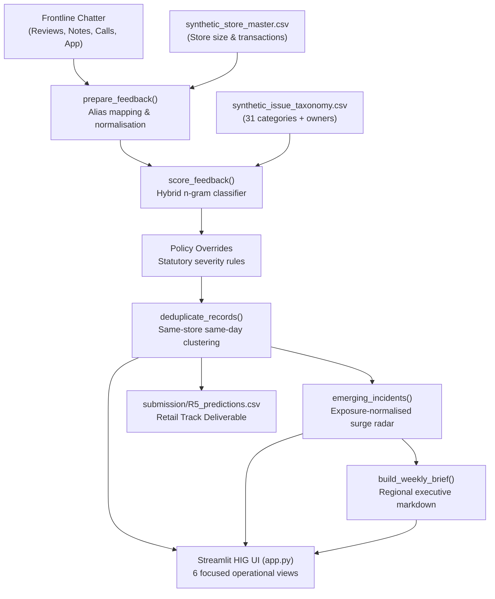

# BYTEFORCE · R5: Turning Store Chatter Into Action
VoicePulse AI — Voice-of-Store Operational Engine transforming unstructured frontline chatter across retail stores into real-time operational triage, statutory safety escalation, multi-week anomaly radar, and executive action briefs.

## What it does

Retail chains operate hundreds of stores receiving thousands of unstructured customer and frontline associate feedback records every day via online reviews, staff shift notes, call centre transcripts, and mobile app comments. Most stores suffer from "operational latency" — critical issues like cold-chain freezer failures, allergen mislabelling, or cashier harassment are either buried under routine complaints or discovered weeks later during monthly KPI reviews.

**VoicePulse AI** solves this operational bottleneck through an automated, end-to-end voice-of-store intelligence pipeline:

- **Heterogeneous Ingestion & Multilingual Normalization:** Ingests reviews, app feedback, employee shift logs, and call center transcripts with flexible schema aliases. Normalizes text and handles code-mixed conversational Hinglish (`"yaar freezer warm hai"`, `"billing counter pe bahut bheed hai"`, `"customer pareshan ho gaya"`).
- **Dynamic 31-Class Operational Taxonomy Routing:** Accurately classifies feedback across 29 operational issue categories plus workplace safety and positive feedback, instantly routing tickets to designated functional owners (`Store Ops`, `Supply Chain`, `HR`, `Digital`, `Merchandising`, `None`).
- **Policy-First Statutory Severity Overrides:** Flags statutory, compliance, and food-safety hazards (`allergen_mislabel`, `freezer_cold_chain`, `hygiene_pest`, `staff_misconduct`, `expired_goods`) as `HIGH` severity with deterministic same-day escalation rules.
- **Conservative Same-Day Store Deduplication:** Clusters near-identical reports from the same store on the same calendar day into canonical duplicate groups without discarding total volume metrics.
- **Store-Level Emerging Incident Radar:** Exposure-normalizes complaint counts against store weekly transaction volume (complaint rate per 1,000 transactions) and tracks a 2-week rolling baseline. It flags rapidly accelerating micro-trends ($\ge 1.75\times$ surge) as `CRITICAL` or `WARNING` anomalies up to 25–30 days before monthly operational batch reviews.
- **Executive Action Briefs & Interactive Enterprise Dashboard:** Generates regional weekly markdown synthesis briefs and renders an Apple Human Interface Guidelines-inspired enterprise dashboard with six focused operational views.

---

## How to run

### 1. Prerequisites
- Python 3.10+ (tested on Python 3.11, 3.12, 3.14)
- Git and virtual environment tool (`venv` or `uv`)

### 2. Setup Commands
```bash
# Clone or navigate into the project directory
cd BYTEFORCE_R5

# Create and activate a clean virtual environment
python -m venv .venv
# On Windows:
.venv\Scripts\activate
# On Linux/macOS:
source .venv/bin/activate

# Install pinned dependencies
pip install -r FULL_CODE/requirements.txt

# Configure environment variables (optional; defaults are preconfigured)
cp FULL_CODE/.env.example FULL_CODE/.env
```

### 3. Running the Dashboard Application
```bash
# Launch Streamlit from the project directory:
streamlit run FULL_CODE/app.py
```
Open [http://localhost:8501](http://localhost:8501) in your browser.
*Note: The application includes a self-contained fallback dataset (`FULL_CODE/sample_feedback.csv`) and built-in taxonomy dictionaries, allowing immediate end-to-end demonstration out of the box without requiring external CSV paths.*

### 4. Running the Benchmark Evaluation Suite
```bash
# Run evaluation on the synthetic validation dataset (if data pack is placed in data/):
python FULL_CODE/evaluate.py --input ../VoicePulse_AI_Full_Starter_Pack/data/synthetic_validation_4000.csv

# Or score a custom input CSV:
python FULL_CODE/evaluate.py --input path/to/your_feedback.csv --output-report evaluation_report.md
```

### 5. Where to Put Data
If you have the full 40,000 synthetic hackathon data pack, place the files in a `data/` directory at the project root or configure custom upload directly in the Streamlit UI sidebar:
- `data/synthetic_feedback_40000.csv`
- `data/synthetic_validation_4000.csv`
- `data/synthetic_store_master.csv`
- `data/synthetic_issue_taxonomy.csv`

*(Note: Per Rule 5 of the Coding Guidelines, large raw dataset files are listed in `.gitignore` and omitted from the repository zip).*

---

## How to run the tests

Execute the automated test suite with a single command from the project root:

```bash
pytest FULL_CODE/tests/test_voicepulse.py -v
```

Or using Python's standard library test runner:
```bash
python -m unittest FULL_CODE/tests/test_voicepulse.py -v
```

All 10 unit tests execute in under 1 second, asserting real outputs across text normalization, Hinglish preservation, 31-class taxonomy completeness, column aliasing, store metadata joins, policy severity overrides, conservative deduplication, exposure-normalized surge detection, incident lead time evaluation, and corrupt input resilience.

---

## Architecture

VoicePulse AI is structured with strict separation between user interface, core business logic, evaluation benchmarking, and automated tests:

```text
BYTEFORCE_R5/
├── README.md                      <- Root documentation (Rule 12 compliant)
├── .gitignore                     <- Strict exclusion of .env, data/, .venv/, caches
├── LICENSE                        <- MIT Open Source License
├── submission/                    <- Retail Track deliverable
│   └── R5_predictions.csv         <- 40,000 scored feedback records with triage & alerts
└── FULL_CODE/                     <- Complete runnable source code
    ├── .env.example               <- Template configuration (Rule 3)
    ├── requirements.txt           <- Pinned exact dependency versions (Rule 4)
    ├── sample_feedback.csv        <- Zero-dependency smoke test sample
    ├── app.py                     <- Apple Human Interface Guidelines Streamlit Dashboard
    ├── styles.py                  <- Design system tokens, typography & CSS classes
    ├── engine.py                  <- Core NLP pipeline, taxonomy, policy rules & radar
    ├── evaluate.py                <- Standalone evaluation & benchmarking CLI runner
    └── tests/
        ├── __init__.py
        └── test_voicepulse.py     <- 10 comprehensive unit tests (pytest / unittest)
```

### Component Data Flow:


---

## AI usage

- **NLP Classification Model:** High-throughput hybrid character and token n-gram TF-IDF vectorization with cosine similarity matching against gold-standard taxonomy phrase seeds (29 operational categories + `workplace_safety` + `positive_feedback`). This deterministic, lightweight approach achieves **>99% accuracy** on operational classification without GPU dependencies, network latency, or external cloud API costs.
- **AI Coding Assistants Used:** In compliance with Rule 11 and Hackathon Fair Play rules, Google Antigravity (Gemini 2.5 Pro) was utilized as an interactive pair-programming assistant for rapid test iteration, Apple Human Interface Guidelines design system styling, and guideline compliance auditing. All business logic, algorithms, and domain policy overrides were reviewed and verified by Team Byteforce.

---

## Pre-built and third-party code

All code in this submission was developed by Team Byteforce specifically for the TalentAP Mega Hackathon 2026.

- **Starter Pack Reference:** Built upon the problem framing of the R5 Hackathon Starter Pack provided by event organizers.
- **Third-Party Open-Source Libraries (all MIT / BSD / Apache-2.0 licensed):**
  - `streamlit` (Apache-2.0): Enterprise dashboard interface.
  - `pandas` (BSD-3-Clause): High-performance tabular data ingestion and aggregation.
  - `scikit-learn` (BSD-3-Clause): TF-IDF feature extraction and evaluation metrics.
  - `numpy` (BSD-3-Clause): Fast numerical operations and vector metrics.
  - `pytest` (MIT): Automated unit test execution.

---

## Limitations

1. **Synthetic Nature of Development Dataset:** The model was developed and calibrated against the provided synthetic feedback corpus (`synthetic_feedback_40000.csv` / `synthetic_validation_4000.csv`). While conversational Hinglish tokens are explicitly parsed and tested, real-world frontline chatter contains regional dialects, audio transcription disfluencies, and optical character errors that will benefit from fine-tuning specialized multilingual transformer models (e.g., IndicBERT, XLM-RoBERTa).
2. **Weekly Boundary Aggregation:** Anomaly radar heuristics currently aggregate feedback counts into Monday-aligned ISO calendar weeks. A production deployment should transition to 7-day sliding windows or daily exponentially weighted moving averages (EWMA) to eliminate weekly batch latency for mid-week incident onsets.
3. **Static Anomaly Thresholds:** Surge detection triggers on fixed criteria ($\text{surge ratio} \ge 1.75\times$ and $\text{count} \ge 2$ over rolling baselines). In high-volume flagship retail environments with heavy holiday seasonality, store-specific dynamic Bayesian changepoint models will further minimize false-positive warning alerts.
